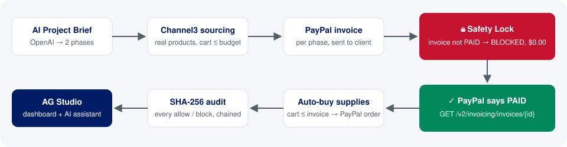

# StageGate AI: a Cashflow Safety Lock for AI purchasing agents

> Built for the [PayPal AI Hackathon](https://paypalaihackathon.devpost.com) on top of the
> [PayPal × AG Grid boilerplate](https://github.com/paypaldev/hackathon-paypal-ag-grid-boilerplate).

Small businesses and freelancers often have to buy materials before the client pays. An AI agent that
shops for you makes this worse: it can spend money you haven't collected yet.

StageGate AI splits a client project into **phases**. Each phase is funded by a **PayPal invoice**.
An AI agent sources the equipment for each phase from real stores through **Channel3**, but a fixed
rule in code, with no AI involved, decides whether it may buy:

> **A phase's supplies can only be bought once PayPal confirms that phase's client invoice is PAID,
> and never for more than that invoice brought in.**

Every approved, blocked and failed attempt is written to a **SHA-256 hash-chained audit trail** and
fed into an **AG Studio** dashboard. Its AI assistant can answer questions such as "how much did the
lock hold back?"



## The demo in 60 seconds

Open <http://localhost:3000>. The StageGate panel is at the top of the page.

| Step | What you do | What happens |
|---|---|---|
| 0 | Click a preset pill (**Pop-Up Espresso Bar ($800)**, **Indie Game Launch Booth ($1,200)**, **Wedding Photo Studio ($950)**) or type your own brief | OpenAI splits the project into 2 phases with invoice amounts, equipment budgets and search terms. Channel3 finds real products, and the timeline resets with both phases **locked (red)**. |
| 1 | **Generate PayPal Client Invoice** | A real PayPal sandbox invoice is created and sent to the client. |
| 2 | **Test Premature AI Buy (Safety Lock)** | The agent tries to buy before the client pays. **Blocked**: `BLOCKED_UNFUNDED_PHASE`, and nothing is sent to PayPal, so $0.00 is charged. |
| 3 | **Verify Client Paid & Auto-Buy Supplies** | StageGate asks PayPal for the invoice status. Once it is `PAID`/`MARKED_AS_PAID` the phase turns **green** and a PayPal order for the cart is created automatically. |
| 4 | **Simulate 4-Day Late Payment** | Phase 2 shifts 4 days later on the timeline, and its supplier spend stays locked. No cash is fronted. |
| ↺ | **Reset Demo** | The same project goes back to fully locked. |

Then open **/dashboard**. The first page, **StageGate Cashflow & Audit**, shows the same data in AG
Studio, and the AI assistant can query it.

> **"Simulate client paid in sandbox"** (on by default) records the client's payment against the
> invoice through PayPal's API, so you don't have to log in as the buyer and wait. The paid check in
> step 3 still reads the status from PayPal.

## Setup

Requires **Node.js 20.9+** and a **PayPal sandbox REST app**.

```bash
npm install
cp env.example .env.local   # then fill in the values below
npm run dev                 # http://localhost:3000
```

### Environment variables (`.env.local`, git-ignored)

| Variable | Required | Purpose |
|---|---|---|
| `PAYPAL_CLIENT_ID`, `PAYPAL_SECRET` | **Yes** | Sandbox REST app credentials (developer.paypal.com → Apps & Credentials, Sandbox). |
| `CHANNEL3_API_KEY` | Recommended | Real product search via Channel3. Without it, a clearly labelled sample catalog is used. |
| `AG_STUDIO_OPENAI_API_KEY` | Recommended | Powers the AI Project Brief and the AG Studio assistant. Without it, preset pills fall back to hand-written plans and custom briefs are disabled. `OPENAI_API_KEY` is used if this is unset. |
| `OPENAI_MODELS` | Optional | Comma-separated OpenAI model ids. The first is used for planning (default `gpt-5.4-mini`). |
| `AG_STUDIO` | Optional | AG Studio licence key for `/dashboard`. |
| `STAGEGATE_CLIENT_EMAIL` | Optional | Who receives the client invoices. Default `stagegate-demo-client@example.com` (see below). |

### PayPal sandbox notes

1. **Apps & Credentials → Sandbox → Create App** (type *Merchant*), then copy the Client ID and Secret.
2. On the app page, enable **Transaction search** under *Features* (needed by `/transactions` and `/balances`).
3. **India-registered sandbox accounts:** PayPal rejects invoices from an Indian business to an Indian
   customer (HTTP 406, *"unable to send invoices to customers within India"*). That's why the default
   client email is an address with no PayPal account, which PayPal treats as international. To pay
   invoices as a real sandbox buyer, create a **US personal** sandbox account and set
   `STAGEGATE_CLIENT_EMAIL` to its email.
4. Everything runs against `api-m.sandbox.paypal.com`. No real money moves.

## How it works

```
lib/stagegate.ts            Safety Lock engine: state, rules, PayPal + Channel3 calls, audit chain
lib/stagegate-ai.ts         AI Project Brief: OpenAI plan + deterministic money guardrails
lib/stagegate-presets.ts    The 3 preset briefs and their offline fallback plans
app/api/stagegate/route.ts  GET project snapshot, POST demo actions
app/stagegate-panel.tsx     The UI: brief, timeline, actions, products, audit trail
lib/dashboard-data.ts       Adds StageGate phases/audit/products to the AG Studio feed
app/dashboard/studio/       AG Studio data sources, relationships and the StageGate report page
lib/paypal.ts               PayPal REST client (OAuth, paging, retries, idempotent POSTs)
```

### The Safety Lock (`attemptSupplierPurchase`)

All amounts are **integer cents**. Floating-point dollars never decide anything.

1. Invoice not `PAID` → `{ allowed: false, reason: 'BLOCKED_UNFUNDED_PHASE: Client PayPal Invoice is not PAID yet ($0.00 charged)' }`. No PayPal call is made.
2. Already purchased → the existing order is returned, so the same supplies are never bought twice.
3. Empty cart → `BLOCKED_EMPTY_CART`.
4. `cartTotalCents > invoiceAmountCents` → `BLOCKED_OVER_FUNDED_AMOUNT`.
5. Otherwise → `POST /v2/checkout/orders` with a unique `PayPal-Request-Id`, and the result is recorded in the audit trail.

"Paid" means PayPal itself reports `PAID` or `MARKED_AS_PAID` from `GET /v2/invoicing/invoices/{id}`.
If PayPal refuses the simulated payment, the demo can mark an invoice paid locally, but only one
that was actually **sent** to the client. A draft never counts.

### PayPal REST calls

| Call | Used for |
|---|---|
| `POST /v1/oauth2/token` | Client-credentials token, cached until just before it expires |
| `POST /v2/invoicing/invoices` (+ `PayPal-Request-Id`) | Create the phase invoice |
| `POST /v2/invoicing/invoices/{id}/send` | Send it to the client |
| `POST /v2/invoicing/invoices/{id}/payments` | Demo only: record the client's payment |
| `GET /v2/invoicing/invoices/{id}` | Verify paid status, straight from PayPal |
| `POST /v2/checkout/orders` (+ `PayPal-Request-Id`) | The supplier purchase, after the lock allows it |

`PayPal-Request-Id` makes these POSTs idempotent, so a network retry can't create a second invoice or order.

### AI Project Brief (`lib/stagegate-ai.ts`)

OpenAI's Responses API is called with a strict JSON schema and returns a project name, a budget, and
2 phases with an invoice amount, equipment budget, duration and shopping search terms. The model only
**proposes**. `validatePlan()` then enforces the money rules in plain code:

- The budget is taken from the brief when it states one (e.g. `$1,200`), so the model can't change it.
- Phase 1 (the deposit) is clamped to 10–60% of the budget, and phase 2 is exactly the rest, so the invoices always add up to the budget.
- Each equipment budget is at most its phase's invoice.
- Durations are 3–30 days and there are at most 3 search terms per phase.

### Channel3 product sourcing

`POST https://api.trychannel3.com/v1/search` with the `x-api-key` header, once per search term. For each
product StageGate keeps the cheapest USD offer. The cart takes, for each search term in order, the most
relevant product that still fits the phase's remaining equipment budget.

### Audit trail

Each entry stores `prevHash` and `hash = SHA-256(seq, time, action, phase, outcome, message, amount, PayPal call, prevHash)`.
Editing, deleting or reordering any past entry breaks the chain, and the UI badge switches from
**✓ Chain intact** to **✗ Chain broken**.

### AG Studio dashboard

`/dashboard` adds three StageGate data sources next to the PayPal ones:

| Source | Contents |
|---|---|
| **StageGate Phases** | Lock state, invoice status, invoiced/collected, equipment budget, cart, spent, held by lock, delay days, blocked attempts |
| **StageGate Audit Trail** | Every action with outcome, PayPal call, amount, `Is Blocked`/`Is Approved` counters and SHA-256 |
| **StageGate Sourced Products** | Channel3 products per phase, price, in cart |

These are linked to each other by phase, and the audit trail is linked to the calendar. The built-in
report opens on a **StageGate Cashflow & Audit** page with KPIs, a per-phase chart, an outcomes donut,
and the phases and audit grids. With an OpenAI key, ask the assistant things like *"How many supplier
purchases were blocked, and for which phases?"*

> If you had saved changes to the built-in report before this page existed, use
> **Reset to default** in the dashboard to see it.

### API

`GET /api/stagegate` returns the project, phases, products, summary and audit (newest first).

`POST /api/stagegate` with JSON `{ "action": ..., "phaseId": "phase-1" | "phase-2" }`:

| `action` | Extra fields |
|---|---|
| `plan_from_brief` | `brief` (10–1000 chars), optional `presetId` |
| `search_products` | optional `phaseId` |
| `create_invoice` | `phaseId` |
| `attempt_premature_buy` | `phaseId` |
| `mark_invoice_paid_and_unlock` | `phaseId`, `simulateClientPaid` (default `true`) |
| `simulate_late_payment` | none (applies to phase 2) |
| `reset_demo` | none |

State is kept in memory and in `.stagegate/state.json` (git-ignored), so it survives refreshes and restarts.

## Limitations (honest list)

- **Sandbox only.** The supplier "purchase" is a PayPal order in `CREATED` state with an approval link. A production version would capture it or pay the supplier directly (e.g. via Payouts).
- **Single project, single user.** There is no login, and the API has no auth or rate limiting. Don't deploy it publicly as-is.
- The paid-status check reads PayPal on demand. Production would also listen for the `INVOICING.INVOICE.PAID` webhook.
- Channel3 search results vary, so the AI-chosen search terms occasionally match an odd product.

## Original boilerplate pages

The boilerplate's PayPal data explorer is still available below the StageGate panel:

| Page | REST calls |
|---|---|
| `/products` | `GET /v1/catalogs/products` (+ each product) |
| `/plans` | `GET /v1/billing/plans` (+ each plan) |
| `/invoices` | `GET /v2/invoicing/invoices` (+ each invoice) |
| `/transactions` | `GET /v1/reporting/transactions` (max 31 days per request) |
| `/balances` | `GET /v1/reporting/balances` |
| `/dashboard` | AG Studio report over all of the above, plus StageGate |

The AG Studio AI assistant's key stays on the server. The browser talks to `/api/ai/responses`, which
adds the key, only allows the configured models, and caps output tokens.

Scripts: `npm run dev`, `npm run build`, `npm run start`, `npm run lint`.

## License

StageGate AI code is released under the [MIT License](LICENSE). It builds on the
[paypaldev/hackathon-paypal-ag-grid-boilerplate](https://github.com/paypaldev/hackathon-paypal-ag-grid-boilerplate)
starter. AG Grid and AG Studio are used under their own licences.
